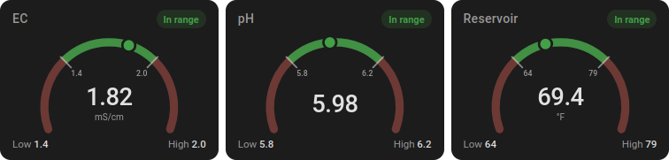
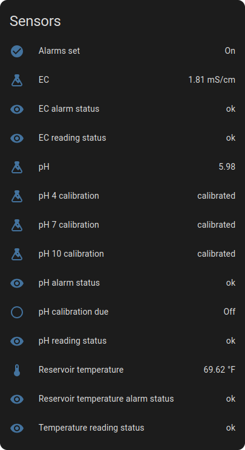
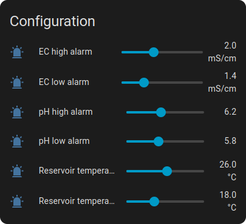
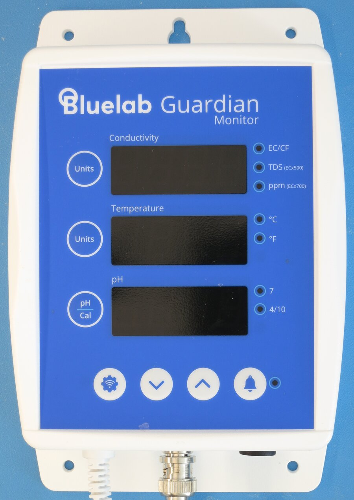
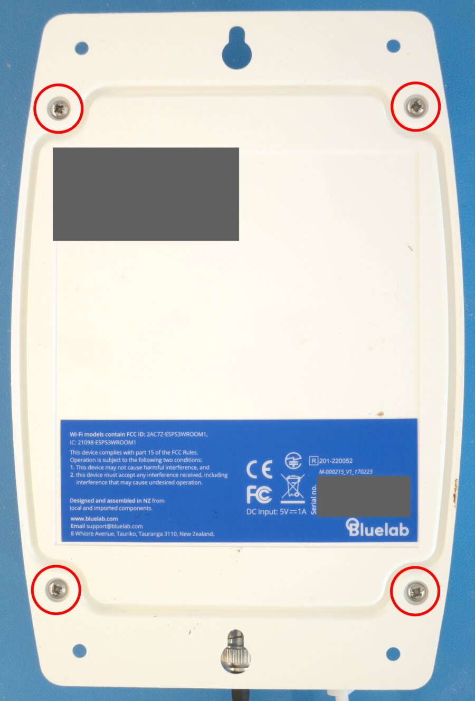
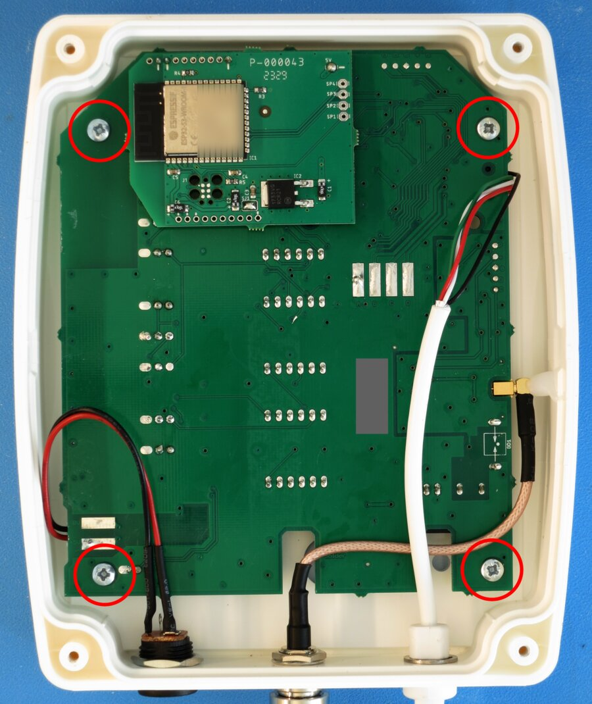
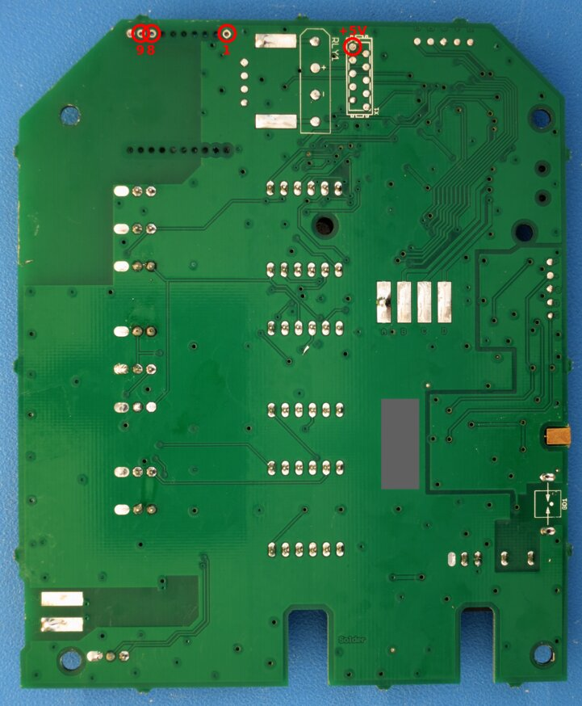
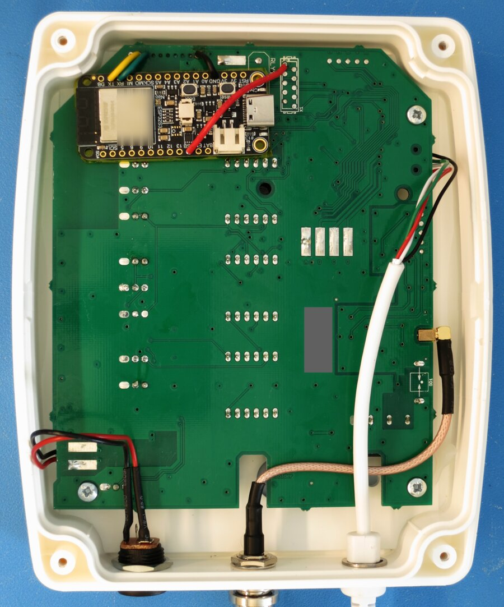

# ESPHome for the Bluelab Guardian

A local Home Assistant integration for the Bluelab Guardian Monitor.

This implementation replaces the stock Wi-Fi module with an Adafruit ESP32-S3 Feather to provide access to sensor readings, alarm settings, and calibration status without using Edenic, Bluelab's cloud service.

> Not affiliated with or endorsed by Bluelab. Opening or modifying your Guardian may void its warranty; you do so at your own risk. See [Disclaimer](#disclaimer).
> 
> Various Claude models and Qwen3.8-Flash-Next were used to generate code and protocol documentation for this project.

## Features

- **Live readings:** Real-time EC, pH, and temperature.
- **Writable alarms:** Read and set low/high alarm thresholds.
- **Comprehensive status:** Per-sensor alarm states and pH calibration status.
- **Front-panel sync:** Changes made on the Guardian's physical panel are reflected in Home Assistant.



<p>


</p>

## Hardware



This project was developed and tested on an Adafruit ESP32-S3 Feather, [product 5323](https://www.adafruit.com/product/5323) (8 MB flash, no PSRAM), and the Bluelab Guardian Monitor Wi-Fi pictured above.

You'll need a soldering iron with desoldering braid, hook-up wire, and Kapton tape to modify the hardware.

> **Why not reuse the Guardian's Wi-Fi module?** It is an ESP32-S3, but Secure Boot is enabled with the manufacturer's key, so it only runs firmware signed by Bluelab.

## Installation

### Configure and flash the Feather

#### 1. Install ESPHome

```bash
python3 -m venv ~/esphome-venv
~/esphome-venv/bin/pip install esphome
source ~/esphome-venv/bin/activate
```

#### 2. Get the code

```bash
git clone <repository URL> esphome-guardian
cd esphome-guardian
```

#### 3. Add your secrets

```bash
cp secrets.yaml.example secrets.yaml
```

Then edit `secrets.yaml`:

| Key | What to put there |
|---|---|
| `wifi_ssid`, `wifi_password` | Your Wi-Fi network name and password |
| `ap_password` | Password for the fallback hotspot (8+ characters) |
| `api_encryption_key` | A new random key generated with `openssl rand -base64 32` |

Keep `secrets.yaml`. Home Assistant asks for the API key when you add the device, and every future update must be built with the same key.

#### 4. Flash over USB

Connect the Feather to the computer with the USB-C cable and run:

```bash
esphome run guardian.yaml
```

Choose the Feather's serial port when asked. The first build downloads ESP-IDF and takes several minutes. It should end with `Successfully uploaded program`, then show the Feather's log. If flashing fails, see [Troubleshooting](#troubleshooting).

#### 5. Test on the bench

1. **Check Wi-Fi:** The log should show the Feather joining your network, with a line like `Hostname: 'guardian-a1b2c3'`. Wherever this guide says `guardian-xxxxxx`, use that name.
2. **Add it to Home Assistant:** It should be auto-discovered in **Settings → Devices & services**. Then, **Configure** *Bluelab Guardian*. If it's not automatically detected, attempt to add it manually using **Add integration → ESPHome** with host `guardian-xxxxxx.local` (or the IP address), port 6053. Enter the `api_encryption_key` from `secrets.yaml`.
3. **Check the device page:** Verify the entities are listed. Most will show as *Unknown* until the Feather is connected to the Guardian.

### Modify the Guardian

Inside the Guardian, a large sensor/display board (with a PIC18 microcontroller) and a small Wi-Fi module (with an ESP32-S3) talk over a 3-wire serial link. The Feather replaces the Wi-Fi module.

Once installed, the Feather is powered by the Guardian and must never be plugged into USB again. Updates and logs are transferred over Wi-Fi.

#### 1. Open the enclosure



1. Unplug the power supply, and unplug the pH probe at its BNC connector.
2. Lay the unit face down and remove the four screws circled in red.
3. Lift the back cover off.

#### 2. Remove the sensor board



The stock Wi-Fi module is the small board at the top left with the metal-shielded ESP32-S3-WROOM-1, soldered to the sensor board through a 10-pin header in the M1 footprint.

1. Remove the four screws at the board's corners (circled in red).
2. Remove the hot glue from the pH probe lead where it connects to the board.
3. As you lift the board out, note how the leads are routed and unplug the power, EC probe, and pH probe leads from the sensor board.

#### 3. Remove the stock Wi-Fi module

Carefully desolder the module's 10-pin header from M1 and the 5 V+ lead with braid or a pump and lift the module away. Snipping the plastic header between the pins helps. Ensure all solder is out of the vias and clean the pads.

#### 4. Wire the Feather



**M1 pads:** The M1 footprint has two rows; the module's header was in the row nearest the top edge of the board (the upper row in the photo). Seen from the back of the board, as in the photo, pad 1 is the right end of that row, next to the large tinned RLY1 pad.

**5 V+ pin:** X1 is the 2 × 5 header footprint just to the right of RLY1 near the top edge. The pin closest to the top edge, in the column closest to RLY1, is where the stock Wi-Fi module was connected to 5 V+.

| Sensor board | Signal | Feather pin |
|---|---|---|
| M1 pad 1 | GND | **GND** |
| M1 pad 8 | Sensor board TX (data out of the sensor board) | **RX** |
| M1 pad 9 | Sensor board RX (data into the sensor board) | **TX** |
| X1, top-left pin | 5 V+ | **USB** |

Leave all other pads and pins unconnected. Solder the four wires as in the table.

- The signal lines are 3.3 V logic. **5 V+ must never touch M1 pads 8 or 9**: it can damage the sensor board.
- Do not connect the Guardian's 3.3 V+ rail to the Feather.
- Never plug a USB cable into the Feather while it is wired to the Guardian.

#### 5. Mount and close up



1. Mount the Feather where the stock module was, over the M1 area, antenna end towards the edge of the board and clear of metal, USB-C port facing inwards. Put insulating tape between it and the sensor board so nothing can short. In the photo, yellow and green are the signal lines, black is GND, and red is 5 V+.
2. Put the sensor board back and refit its four screws, reconnecting and routing the leads as they were.
3. Refit the back cover.

#### 6. Power up and check

Plug the pH probe and the power supply back in. The Feather starts with the Guardian and joins Wi-Fi. Within a minute, EC, pH, and Temperature should show readings in Home Assistant and *PIC link connected* should be on. If not, see [Troubleshooting](#troubleshooting).

## Usage

### Entities

| Entity | Type | What it is |
|---|---|---|
| **EC** | sensor, mS/cm | Conductivity |
| **pH** | sensor | pH |
| **Temperature** | sensor, °C | Solution temperature |
| **EC / pH / Temperature alarm status** | text: `ok` / `low` / `high` | The Guardian's low and high alarm flags for that sensor |
| **EC / pH / Temperature reading status** | text: `ok` / `under range` / `over range` / `disconnected` / `sensor fault` / `dependent sensor fault` | The status of each reading (fault values are not yet confirmed on a live unit) |
| **pH calibration due** | binary sensor | The Guardian's calibration reminder: on while a pH buffer (pH 4, 7, or 10) is due, shown as a flashing pH lamp; set 30 days after the last full calibration |
| **pH 4 / pH 7 / pH 10 calibration** | text: `calibrated` / `due` / `none` | Status of the Guardian's two calibration lamps, per buffer: `due` = that buffer's lamp is flashing, `calibrated` = steady, `none` = off (no calibration stored, e.g., after a failed one) |
| **pH 4 / pH 7 / pH 10 calibration voltage** | sensor (Diagnostic), V | The electrode voltage the Guardian recorded at that calibration (about +0.16, 0, and -0.16 V for a healthy probe) |
| **Alarms set** | binary sensor | The Guardian's "alarms set" flag |
| **EC / pH / Temperature low alarm, high alarm** | number (Configuration), writable | The Guardian's alarm thresholds |
| **PIC link connected** | binary sensor (Diagnostic) | On while the Guardian is answering |
| **Device mode** | text (Diagnostic) | `monitor` normally; `settings` or `calibration` while the Guardian is in settings mode (changing alarms or calibrating with the buttons); `unknown` when the link is down |
| **Board status words** | text (Diagnostic) | The Guardian's raw state messages in hex, for protocol work: `04` = sensors in low alarm, `05` = sensors in high alarm, `07` = pH buffers due for calibration, plus the status byte of each reading (`11`); see [docs/PROTOCOL.md](docs/PROTOCOL.md) §12 |
| **Board calibration records** | text (Diagnostic) | The Guardian's three pH calibration records, pH 4, 7, and 10 in that order: write counter `n`, valid flag `f`, electrode voltage `a`, and temperature `b` at calibration; see [docs/PROTOCOL.md](docs/PROTOCOL.md) §12 |
| **Uptime** | sensor (Diagnostic) | Seconds since the ESP32 started; a drop to 0 means it rebooted |
| **Wi-Fi signal** | sensor (Diagnostic), dBm | Signal strength |

Alarm status and the calibration reminder are the same flags the stock Wi-Fi module reported.

> **Alarm status and the reading can look inconsistent.** The Guardian decides its alarms on the value it displays, rounded to one decimal, and a reading that rounds to the threshold counts as in alarm. Home Assistant receives the reading with two decimals, so you can see EC 1.98 reported as `high` against a high alarm of 2.0. Both are correct: the alarm status is the Guardian's verdict, the reading is the full-precision value. If you want alarms that compare the two-decimal reading with your own thresholds, build them in Home Assistant from the EC, pH, and Temperature sensors instead; the alarm status entities are there for those who want what the Guardian shows.

### Update rates

| What | How often |
|---|---|
| EC, pH, temperature | Every 1–2 s (3 in every 5 cycles) |
| Reading status | With each reading, published on change |
| Alarm thresholds and "alarms set" | Re-read every 5 s |
| Alarm status and pH calibration due | Re-read every 5 s, and right after the Guardian leaves settings mode |
| pH 4 / 7 / 10 calibration, voltages, and board calibration records | Re-read every 60 s, and right after the Guardian leaves settings mode |
| Wi-Fi signal | Every 60 s |
| Everything | Read at start-up: all entities have values within a few seconds |

The Guardian already conditions its readings, so the firmware applies no smoothing. To send fewer updates to Home Assistant, add a standard ESPHome `filters:` block to a sensor in `guardian.yaml`, e.g. `throttle_average: 30s`.

### Changing alarm thresholds

Set a threshold from Home Assistant (the number entity, an automation, or a script) and the firmware writes it to the Guardian:

- **A change is confirmed by reading it back**, not by the Guardian's acknowledgement; normally about a second.
- **Quick successive changes are merged**, for example EC low then EC high a moment later, or EC and pH together. All are applied.
- **Low above high is refused** and the entity snaps back to the Guardian's value. The log shows `rejected alarm write …`.
- **If the Guardian hasn't taken a change within 20 s**, the firmware gives up and the entity shows the Guardian's value again. The log shows `… not confirmed; giving up`.
- **Ranges offered in Home Assistant:** the Guardian's measurement ranges, EC 0–5 mS/cm, pH 0–14, temperature 0–50 °C.

### Changes made on the Guardian

The Guardian's buttons keep working. Modified alarm thresholds reach Home Assistant within about 5 s of leaving settings mode.

While the Guardian is in settings mode, it stops answering. *Device mode* shows `settings` or `calibration`, the readings freeze at their last values, and *PIC link connected* stays on. When the Guardian leaves settings mode, everything resumes. If it stays in settings mode for more than about 60 s without sending anything, the link is treated as lost (below) and recovers by itself once the Guardian leaves settings mode.

"Alarms set" can read off for a while right after an alarm is changed in settings mode, then on again. (This is how the Guardian reports it.)

### Units

Values are in the Guardian's native units, EC in mS/cm and temperature in °C, no matter what its display is set to: a 95 °F alarm set on the panel appears as 35 °C. Home Assistant may convert the *Temperature* sensor to °F on a US-units system; the alarm thresholds stay in °C.

### When the link is lost

If the Guardian is silent for 6 s (60 s in settings mode), *PIC link connected* turns off, *Device mode* shows `unknown`, and EC, pH, and Temperature become *Unknown*. The firmware keeps polling and recovers within seconds of the Guardian answering again. Common causes:

- **The EC probe lead is unplugged inside the Guardian.** The Guardian turns its serial link off without it. Plugging it back in restores the link.
- **The Guardian lost power.** It takes up to ~20 s to boot.
- **A wiring fault.** See [Troubleshooting](#troubleshooting).

### Updating the firmware

Over Wi-Fi, from the directory holding the same `secrets.yaml`:

```bash
esphome run guardian.yaml --device guardian-xxxxxx.local
```

## Troubleshooting

### Common problems

| Symptom | Check |
|---|---|
| *PIC link connected* stays off; `PIC link up` never appears in the log | Is the EC probe lead plugged into the sensor board? Are TX and RX swapped (Feather TX goes to the sensor board's RX)? Is GND connected? Is the Guardian in settings mode? With a meter, both lines should idle at about 3.2 V. |
| Readings show *Unknown* | The link was lost: see the row above. |
| Readings freeze but stay available; *Device mode* = `settings` or `calibration` | The Guardian is in settings mode. Normal. |
| A threshold changed in Home Assistant jumps back | Low was above high, or the Guardian didn't take it within 20 s. Look for the warning in the log. |
| The Feather doesn't start after flashing; its log shows `boot:0x0 (DOWNLOAD(USB/UART0))` / `waiting for download` | Press the Feather's **RESET** button (not BOOT). For other flashing problems, see ESPHome's [USB installation FAQ](https://esphome.io/guides/faq/#i-cant-get-installation-over-usb-to-work). |
| *Uptime* keeps dropping to 0 | The ESP32 is rebooting. Check the log for a crash report and suspect the power supply; see [More help](#more-help). |

### Reading the log

In Home Assistant, check *PIC link connected*, *Device mode*, *Uptime*, and *Wi-Fi signal*, plus the entity history for dropouts. For the live log over Wi-Fi:

```bash
esphome logs guardian.yaml --device guardian-xxxxxx.local
```

At INFO level the component logs only these events:

| Log line | Meaning |
|---|---|
| `PIC link up` | The Guardian is answering |
| `PIC link lost (silent for 6000 ms)` | Silent for 6 s (60 s in settings mode) |
| `device mode: …` | The Guardian changed mode; `settings` or `calibration` means it is in settings mode |
| `status words: …` | The Guardian's status words changed: `low` = sensors in low alarm, `high` = sensors in high alarm (bits: EC, temperature, pH), `due` = pH buffers due for calibration (bits: pH 4, 7, 10) |
| `queued alarm write …` | A threshold change from Home Assistant is being sent |
| `rejected alarm write …` | Refused (low > high, or not encodable) |
| `alarm write … not confirmed; giving up` | Not read back within 20 s |

For more detail, set `logger: level: DEBUG` in `guardian.yaml` and update over Wi-Fi; DEBUG adds `alarm write confirmed …` and every published value. Set it back afterwards. To log every byte on the link, see [docs/PROTOCOL.md](docs/PROTOCOL.md) §14.

### More help

From the ESPHome and Home Assistant documentation:

- [I can't get installation over USB to work](https://esphome.io/guides/faq/#i-cant-get-installation-over-usb-to-work).
- [Getting a stack trace from crashes](https://esphome.io/guides/troubleshooting/#getting-a-stack-trace-from-crashes): crash reports are kept across reboots and shown by `esphome logs` over Wi-Fi, with no USB cable needed.
- [Brownout detector was triggered](https://esphome.io/guides/faq/#brownout-detector-was-triggered) and [My node keeps reconnecting randomly](https://esphome.io/guides/faq/#my-node-keeps-reconnecting-randomly).
- [Adjusting log levels](https://esphome.io/guides/troubleshooting/#adjusting-log-levels-for-debugging).
- [Safe mode](https://esphome.io/components/safe_mode/): after repeated failed boots only Wi-Fi and OTA run, so a fixed build can still be uploaded over the air.
- [ESPHome integration troubleshooting](https://www.home-assistant.io/integrations/esphome/#troubleshooting) in Home Assistant.

## Protocol

The Guardian's serial protocol (framing, messages, timing, and observed behaviour) is described in [docs/PROTOCOL.md](docs/PROTOCOL.md).

## Disclaimer

This is an independent project, not affiliated with, endorsed by, or supported by Bluelab. "Bluelab" and "Guardian" are used only to identify the compatible product. The protocol was worked out for interoperability. The firmware does not modify the Guardian's firmware, but installing it requires opening the unit and changing its wiring, which may void the warranty and could damage it if done incorrectly. Use at your own risk. The software is provided as is, without warranty.

## License

[MIT](LICENSE).
